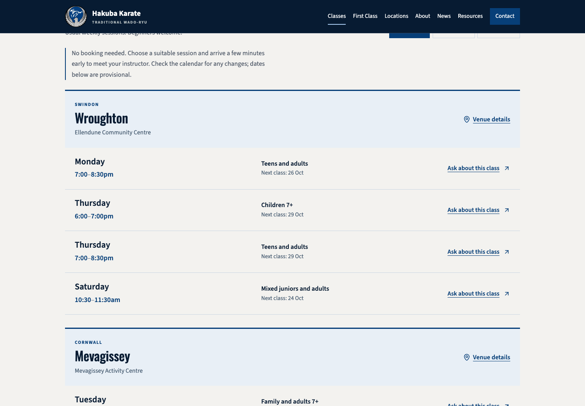
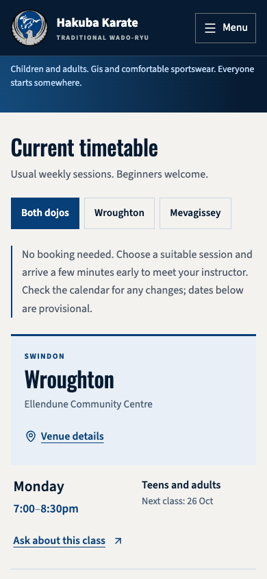
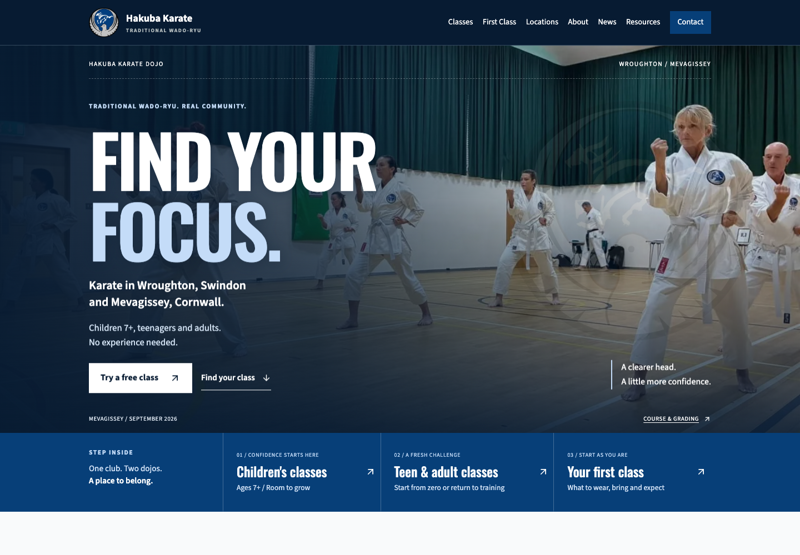

# Hakuba website review, 23 October 2026

## Brief and scope

Audit the current rebuild, explain how to improve it and provide a source-review branch for an independent Grok opinion. Preserve Hakuba's blue editorial personality and real community photography. Do not modify the live website, publish to Pages, redesign pages, submit enquiries, alter member progress or migrate accounts in this pass.

Acceptance evidence: current desktop/phone captures, observed navigation and resource interactions, concrete source findings, local compilation/lint, an explicit publication manifest and remote branch parity. Stop after review handoff; do not merge or deploy. Recommendations below are not implemented fixes.

## Verdict

The visual identity is strong enough to refine rather than replace. The blue hero, purposeful typography, real training photographs and accessible first-visit tone are the best parts. Completion and clarity now matter more than adding visual effects.

The highest priority is not another hero redesign. It is establishing one authoritative WordPress experience, making class selection faster and finishing the genuine joining/member journeys. This is reviewable source, not launch-ready delivery.

## What was actually inspected

The disposable WordPress runtime used earlier is no longer available. Its preview starter fails explicitly rather than installing or contacting production. Current rendered evidence therefore comes from the React reference at localhost:4173, not WordPress. Native WordPress and members-app findings are source-based. No current signed-in app screen or authentication-flow acceptance is claimed.

Browser plugin unavailable; used isolated regular Playwright/Chrome. External requests and non-GET/HEAD requests were blocked. No real account login, form submission, score, saved progress or external communication occurred. Screenshots are current audit evidence, not old captures.

### Visitor flow

| Step | Surface/action | Current health and limit |
| --- | --- | --- |
| 1 | Homepage and entry choices | Strong visual identity. React homepage is 10,280px tall at 1440px width; its repeated detail dilutes the main decision. |
| 2 | Classes, children, adults and first visit | All render with one H1; the real Thursday children 7+ session is present. Class selection remains too verbose. |
| 3 | Filter timetable by Mevagissey | Button becomes pressed and only Mevagissey remains. Dates are React calculations, not a current CMS feed. |
| 4 | Locations and both dojo detail routes | Rendered addresses and venue links present. Monthly Winterbourne information must remain distinct from the normal Wroughton venue. External map destinations were not exercised. |
| 5 | Contact | Readable two-column desktop form and direct phone/email. React is local sample capture; WordPress source disables submission. No delivery checked. |
| 6 | Resources and first syllabus | First reading edition opens to 9th Kyu / Red belt. Ten public PDF resources are included. Accuracy still needs instructor sign-off. |
| 7 | Member access information | Approval requirement is clear in React. Actual WordPress login, approval, persistence and signed-in UI are not runtime-checked in this audit. |
| 8 | Phone navigation | Menu opens; Escape closes it and returns focus to the toggle. Touch/VoiceOver/physical-device behaviour not established. |
| 9 | Unknown React URL | Blank screen, no H1 and HTTP 200 from the preview fallback. Needs a useful not-found page; deployed HTTP status needs separate handling. WordPress already has a separate 404 template. |

All 15 public routes were rendered at 1440px and 390px widths: no broken image elements, document-level horizontal overflow or page-script errors observed. The extra unknown path was also captured at both widths. These observations are not full accessibility, cross-browser or production acceptance. This was a breadth scan plus focused review, not a line-by-line reading of every pixel on every page.

## Priority improvements

### 1. Resolve the contact journey before launch

**High, source-confirmed integration gap.** The native WordPress form is disabled in `wordpress/hakuba-theme/inc/content.php` (`hakuba_contact_form`). The React API reports local mode; its successful preview capture would not send to the club. WordPress timetable links pass class selection parameters that its generic disabled form does not consume.

Recommended: either connect a club-approved WordPress receiver with routing, delivery receipts/failures, spam controls, retention and approved privacy copy, or remove the disabled preview and make phone/email and no-booking attendance the clear routes. If a form is retained, preserve location, age group and selected session. Submission and delivery verification require separate authorisation; none was attempted here.

### 2. Establish WordPress as the authoritative experience

**High, source-confirmed drift.** `src/pages/HomePage.jsx` still contains the removed floating hero note, different children's imagery, static venue-photo selections and a full dated timetable. `wordpress/hakuba-theme/views/home.php` uses different bundled children's imagery, a compact weekly overview and instructor portrait treatment. WordPress venue photographs depend on CMS assignments; those current assignments were not available to verify. React header lacks the separate App entry that the WordPress header has. Repeated calendar-source notes exist in React but were already removed from the native schedule.

Recommended: restore reproducible native WordPress staging, with a documented, non-sensitive content fixture/export process. Keep WordPress canonical. Record intended React differences rather than pretending both surfaces are identical. Do not regenerate the PHP templates from the older React output. Update screenshots and editorial sign-off against native staging.

### 3. Make the timetable effortless to scan

**Medium, current visual evidence.** Day/time and audience are separated by a wide gap on desktop. Thursday appears twice with equal visual weight; children's 6-7pm and adult 7-8:30pm sessions are not instantly distinguishable. Each phone row adds another enquiry link and next-date line. The guidance and venue headings take substantial vertical space before the first session.

Recommended treatment: group by day, then give each session one clear time-and-audience row. Give Children 7+, Teens/adults and Mixed restrained text badges, not colour-only distinctions. Keep dojo filtering. On phones, place time and audience together, with venue/help secondary. Keep the authoritative full timetable on Classes and compact summaries elsewhere. Do not replace the timetable with generic cards. Show dated notices only when relevant; do not imply a live feed where one is not connected.

### 4. Shorten the homepage without losing its personality

**Medium, rendered React reference.** The opening is compelling; the page then repeats class selection, pathways, joining reassurance, venues, beginner steps and a final invitation. Detailed calendar warnings interrupt the introduction. The current React page needs over ten desktop viewport heights to reach the bottom at the inspected size.

Recommended: preserve the hero and logo treatment. Follow it with a short class chooser, compact timetable, two balanced audience pathways, real instructors/affiliations, two dojo features, short first-visit reassurance, member-resource teaser and latest community update. Merge repeated reassurance. Give supporting pages the depth instead. Set a purposeful content budget, not an arbitrary blank-space reduction.

### 5. Complete the information parents and adults actually need

**Medium, current content gap.** Fees/licence costs and exact trial terms are not confirmed in the inspected records. Parents can watch, but there is no visible approved safeguarding policy/welfare-contact route in the inspected public footers. Do not invent prices, named safeguarding staff or guaranteed anti-bullying outcomes. The repeated free-class offer needs its conditions confirmed, not assumed false.

Recommended: publish confirmed costs and what they include, the club's approved trial terms, parent-watching information, welfare contact/policy and privacy information. Make these easy to reach from Kids, First Class and the footer. Add practical arrival/parking/accessibility details only after venue confirmation. Obtain approved Rob/Andrea portraits and short personal teaching introductions; keep Sensei titles and confirmed ranks.

### 6. Make the news feel current rather than archival

**Medium, source and visual evidence.** React news data leads with March 2026 while the image library includes September 2026 training. The listed news is genuine, not fabricated; its age is a presentation/content freshness issue. Native WordPress uses normal published Posts, which were not available to inspect in a current database.

Recommended: prepare brief club-approved September course/grading reports using confirmed dates and real photos, not invented quotations or results. Add meaningful excerpts and consistent categories. Retain original dates and mark archive links clearly. Give future editors a simple Posts/Media workflow rather than another separate CMS.

### 7. Close the routing and resource migration gaps

**Medium.** `src/App.jsx` has no catch-all route; the unknown-path capture is blank. Existing `/grading-syllabus/`, `/karate-terminology/`, `/katas-of-wadoryu/` and `/calendar/` links are not React routes. Their live existence was not checked and must not be described as broken. The WordPress theme can preserve existing Pages, but installing a theme does not migrate them.

Recommended: add a helpful React fallback for review use, and a deliberate WordPress URL/content migration map. Preserve useful existing resource URLs or implement approved redirects. Verify canonical URLs, sitemap entries, metadata, real status codes and internal resource links on restored staging. No ranking uplift or search-engine inclusion is promised by source metadata.

### 8. Finish member deployment and protect progress consistency

**High for deployment, medium for source-derived robustness risks.** The standard WordPress package deliberately excludes the member app and local delivery adapter. `integrations/wordpress/hakuba-member-app-local.php` only runs locally. Source publication does not connect production identities or migrate learning history.

Two additional bounded source findings:

- `hakuba_local_app_calendar()` maps every non-Wroughton session to Mevagissey. Winterbourne is a supported CMS location, so a future Winterbourne session could enter the wrong app group. Current CMS records were not inspected.
- `hakuba_local_app_save()` replaces submitted top-level progress sections without a revision precondition. Older tabs/devices could overwrite newer nested progress. This is a source-derived risk, not a reproduced loss of records.

Recommended: production-safe approved-member delivery as a separate integration, explicit location mapping, revision/conflict handling, user-visible save status and a controlled migration/rollback plan. Then review the app's full signed-in phone/desktop flow. Preserve its adaptive quiz, expanded Wado stances, achievements and shared design; do not mistake the syllabus selector for an earned grade. Have Sensei approve technical descriptions before presenting them as club instruction.

### 9. Make ongoing editing maintainable

**Medium, source inspection.** The WordPress plugin already owns venues, sessions and exceptions, which is useful. Much landing-page copy remains PHP-template-managed and the member app is a large embedded HTML/script document. Historical implementation notes describe several different project stages.

Recommended: one current-state record; bounded WordPress editing controls for recurring club copy/photos; no second CRM pretending to be production. Keep existing app modules separate and gradually extract remaining monolithic logic without changing learning IDs or stored progress. Design review should not authorise a wholesale architecture rewrite.

## What to keep

- Actual Hakuba logo, navy/blue palette, strong heading type and restrained motion.
- Real local photography, distinct audience pathways and non-intimidating beginner language.
- The correct Wroughton Monday, Thursday children's/adult and Saturday mixed sessions; no Tuesday Wroughton session.
- Clear separate Mevagissey training and monthly Winterbourne guidance.
- Public reading editions plus original syllabus PDFs.
- Authentic federation membership links without unsupported competitor comparisons.
- Server-side approval gating, separate selected-study and earned-grade concepts, and no invented member progress.

## Evidence and limits

- `npm run lint`: passed for React source.
- `npm run build`: passed; 15 public routes prerendered.
- `npm run member:build` and `npm run wordpress:build`: passed locally; no installation or deployment.
- Arbiter independently checked PHP syntax for all 36 WordPress/integration files and Node syntax for server/build/frontend scripts: passed.
- All 15 React routes plus one unknown path captured at desktop and phone widths. No assertion-based suite, scored practice or form submission ran.
- Focused interactions observed: dojo filter, syllabus disclosure, mobile menu/Escape/focus return.
- No current native WordPress rendering, real enquiry delivery, private production login, member persistence/concurrency, Safari/Firefox, physical device, full accessibility, Core Web Vitals field data or search ranking audit.
- Publication safety was reviewed separately from launch readiness. Photos were explicitly cleared by the owner for public project use. No claim of a general reuse licence is made.

The bundled screenshots are selected current React captures, not a deployment or evidence that the native members app was exercised.

## Suggested next implementation order

1. Restore reproducible WordPress staging and one authoritative content state; obtain confirmed trial terms, fees and safeguarding information alongside this work.
2. Resolve the contact journey: connect an approved receiver or remove the disabled preview and emphasise the working contact/attendance routes.
3. Implement the clearer day/audience timetable and shorter homepage in that canonical theme, using the confirmed offer and club information.
4. Add approved instructor introductions and refresh genuine club news.
5. Complete production member delivery, explicit calendar mapping and progress-conflict handling.
6. Repeat native desktop/mobile/keyboard checks and the URL migration review before a separately authorised launch.

## Independent Grok review request

Read README first. Treat WordPress as the intended production platform and React as a potentially older design reference. Review the source and current screenshots independently. Prioritise beginner/parent clarity, timetable readability, first-visit friction, editorial rhythm, accessibility risks, local content usefulness, maintainability and integration gaps. Separate demonstrated defects from suggestions and launch prerequisites. Do not infer teaching quality or make claims about competing clubs. Do not deploy, enable forms, change credentials or modify member data. Return severity-ranked findings with file references, then the three improvements with the greatest likely visitor benefit. A visual score must not imply production readiness.
